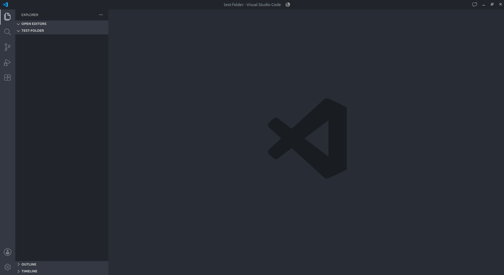
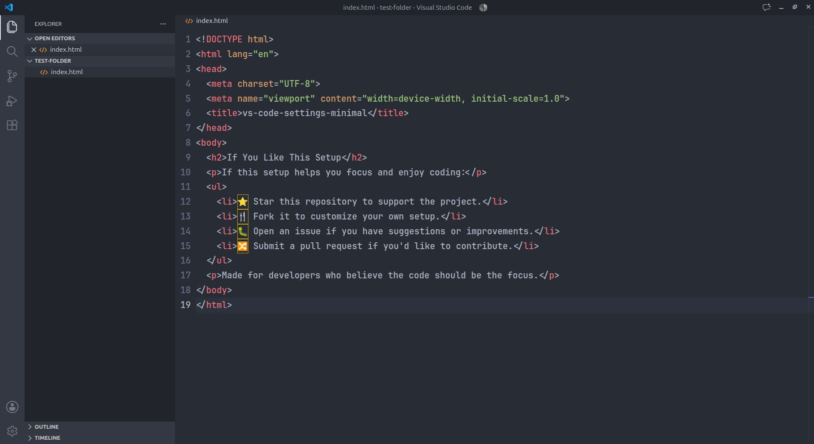
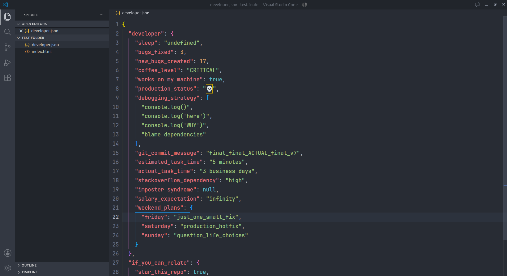

# Minimal VS Code Setup — Atom One Dark

A clean, code-first Visual Studio Code configuration built for focused development. Combines the **Atom One Dark** theme, JetBrains Mono typography, a minimal interface, and keyboard-driven navigation.

<p align="center">
  
</p>

<p align="center">
  
</p>

<p align="center">
  
</p>

## Preview

- **Theme:** Atom One Dark
- **Font:** JetBrains Mono Nerd Font
- **Font size:** 17px
- **Font weight:** Semi-bold (600)
- **Line height:** 1.7
- **Editor layout:** Minimal, distraction-free
- **Workflow:** Keyboard-first navigation

## Features

### Typography & Readability
- Large, semi-bold JetBrains Mono text.
- Smooth cursor animations and scrolling.
- Bracket pair colorization and indentation guides.
- Clean line highlighting for easier code tracking.
- Automatic formatting on save and paste.

### Minimal Interface
- Hidden Activity Bar and Status Bar.
- Disabled minimap, breadcrumbs, and sticky scroll.
- Compact editor tabs with minimal visual clutter.
- Hidden editor action buttons and window Command Center.
- Reduced Explorer decorations and compact folders.
- Zen Mode support for distraction-free coding.

### Developer Productivity
- Automatic saving after one second.
- TypeScript and TypeScript React formatting with Prettier.
- Python formatting with Black.
- Automatic TypeScript import updates when files move.
- Git auto-fetch with reduced confirmation prompts.
- Contextual suggestions enabled while typing.

### Keyboard-First Navigation

| Action | Shortcut |
|---|---|
| Command Palette | `Ctrl + Shift + P` |
| Quick Open File | `Ctrl + P` |
| Search Across Files | `Ctrl + Shift + F` |
| Explorer | `Ctrl + Shift + E` |
| Extensions | `Ctrl + Shift + X` |
| Source Control | `Ctrl + Shift + G` |
| Toggle Terminal | `` Ctrl + ` `` |
| Toggle Zen Mode | `Ctrl + K`, then `Z` |

## Theme & Font Setup

### 1. Install Atom One Dark

Install the **Atom One Dark Theme** extension from the VS Code Marketplace and select it using:

`Ctrl + Shift + P` → `Preferences: Color Theme` → `Atom One Dark`.

### 2. Install JetBrains Mono

Download JetBrains Mono from the official website:

https://www.jetbrains.com/lp/mono/

Install the font on your system, then restart VS Code.

For semi-bold typography, ensure the SemiBold font weight is installed. The configuration requests weight `600`.

### 3. Apply Settings

Copy the provided configuration into your VS Code `settings.json`.

Open it using:

`Ctrl + Shift + P` → `Preferences: Open User Settings (JSON)`.

### 4. Enable Distraction-Free Coding

Press `Ctrl + K`, then `Z` to enter Zen Mode. This hides additional interface elements so you can focus on the code.

## Design Philosophy

The goal is simple: **the code should be the interface.**

- Less visual clutter.
- Larger, readable typography.
- Minimal interface elements.
- Keyboard shortcuts instead of permanent toolbars.
- Essential coding assistance without unnecessary distractions.

## Customization

Adjust these settings to suit your screen:

```json
{
  "editor.fontSize": 17,
  "editor.fontWeight": "600",
  "editor.lineHeight": 1.7,
  "editor.minimap.enabled": false,
  "breadcrumbs.enabled": false,
  "workbench.statusBar.visible": false,
  "workbench.activityBar.location": "hidden"
}
```

Increase `editor.fontSize` to `18` or `19` for larger text.

## Notes

- Keyboard shortcuts may vary if you've customized your keybindings.
- Some interface settings depend on your VS Code version.
- The custom CSS extension and its imported stylesheet are optional; remove their settings if you don't use them.
- This repository contains personal editor preferences, not a complete development environment.

## License

Released under the MIT License. Feel free to adapt this configuration to your own workflow.
