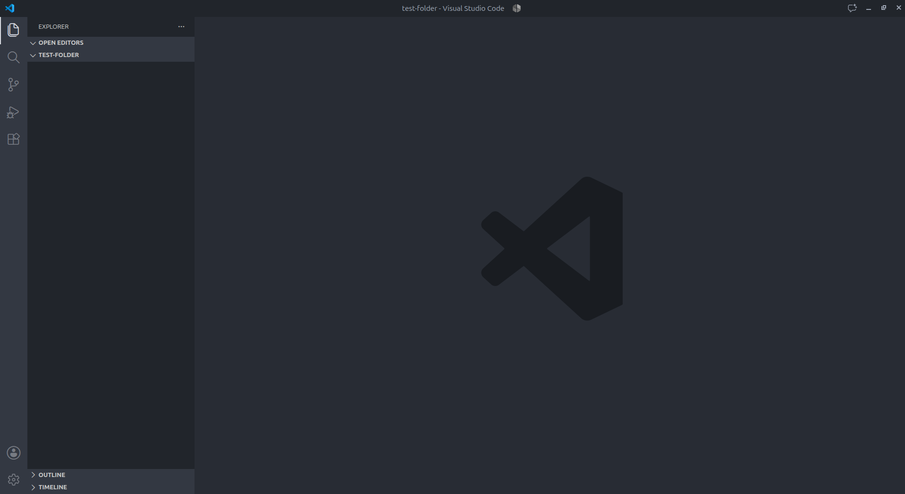
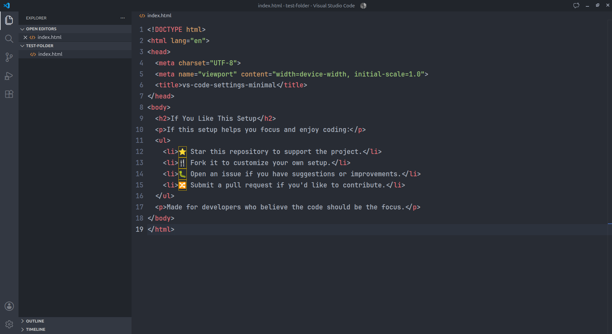
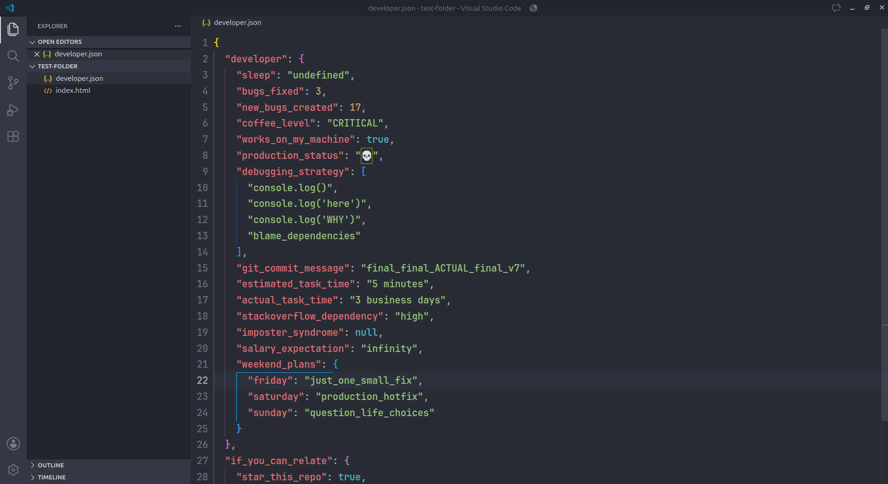

# Minimal VS Code Setup — Atom One Dark

A clean, code-first VS Code configuration: Atom One Dark, JetBrains Mono, minimal UI, keyboard-driven.

<p align="center">
  
</p>
<p align="center">
  
</p>
<p align="center">
  
</p>

## Overview

- **Theme:** Atom One Dark
- **Font:** JetBrains Mono, 17px, semi-bold (600), line height 1.7
- **Interface:** Activity bar, status bar, minimap, breadcrumbs and sticky scroll hidden
- **Workflow:** Auto-save, format on save/paste (Prettier for TS/TSX, Black for Python), Git auto-fetch

## Setup

1. Install the **Atom One Dark Theme** extension, then select it via `Ctrl+Shift+P` → `Preferences: Color Theme`.
2. Install [JetBrains Mono](https://www.jetbrains.com/lp/mono/) (include SemiBold) and restart VS Code.
3. Copy the provided config into `settings.json` via `Preferences: Open User Settings (JSON)`.

## Key Shortcuts

| Action | Shortcut |
|---|---|
| Command Palette | `Ctrl+Shift+P` |
| Quick Open | `Ctrl+P` |
| Search Files | `Ctrl+Shift+F` |
| Toggle Terminal | `` Ctrl+` `` |
| Zen Mode | `Ctrl+K`, `Z` |

## Customization

```json
{
  "editor.fontSize": 17,
  "editor.fontWeight": "600",
  "editor.lineHeight": 1.7,
  "editor.minimap.enabled": false,
  "breadcrumbs.enabled": false,
  "workbench.statusBar.visible": false,
  "workbench.activityBar.location": "hidden"
}
```

## Notes

These are personal editor preferences, not a full dev environment. The custom CSS extension is optional.

## License

MIT
